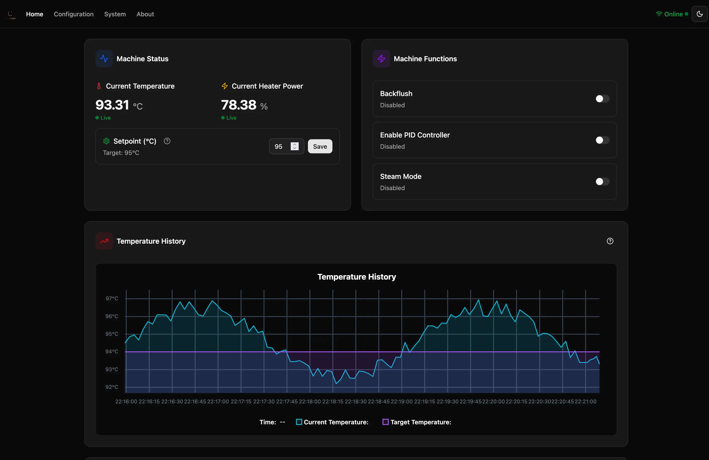

<div align="center">

# CleverCoffee (Rust)

**PID temperature control firmware for espresso machines (Rancilio Silvia, Gaggia and others) on the ESP32, written in Rust.**<br>
Brew-by-time and by-weight, steam, hot water, backflush, OLED display, web UI, MQTT with Home Assistant discovery, HX711 and Bluetooth scales.



</div>

## Why

This is a fork of [CleverCoffee](https://github.com/rancilio-pid/clevercoffee), rewritten from C++/Arduino to Rust:

- **Tested without hardware**: the machine logic, PID, API, MQTT, sensor protocols, every display screen and every HTTP route run as host tests (`just test`).
- **One file to flash**: the web UI is built into the firmware; updates upload a single `.bin`.
- **Safer by construction**: one control loop owns heater, pump and valve; a watchdog resets a hung loop and a panic switches every relay off.
- **Choose what you need**: `minimal`, `standard` (MQTT + display) or `full` (+ scales, pressure sensor) images.

## Install

Flash a release image over USB (the first install erases the C++ firmware and its settings):

```bash
espflash write-bin --chip esp32 0x0 clevercoffee-standard.bin
```

Then join the WiFi `CleverCoffee-XXXX` (password `CleverCoffee`), open http://192.168.4.1 and enter your network under *System*. Or set it before the first boot: `just provision --ssid Home --password secret`. More: [docs/firmware.md](docs/firmware.md).

## Features

### Coffee

- **PID** with separate brew-detection and steam tunings, PonM option, EMA filtering.
- **Brew** by time or by weight, pre-infusion, shot timer, shot counter with backflush reminder.
- **Steam, hot water, manual flush, backflush** cycles, each with a time cap.
- **Standby** after inactivity; the display switches off later.

### Hardware

- **Sensors**: TSIC 306 or DS18B20 temperature, HX711 (1 or 2 load cells) or Bluetooth scales (Acaia, Felicita, Bookoo, Decent, WeighMyBru), ABP2 pressure, water tank switch.
- **Display**: SSD1306/SH1106 128×64, six layouts, English/German/Spanish.

### Connected

- **Web UI** for every parameter, live chart, config backup and restore, firmware update.
- **MQTT** with Home Assistant discovery; mDNS as `<hostname>.local`.

## FAQ

### Can I keep my settings from the C++ firmware?

No. The settings format changed; export nothing, flash over USB, set up again (about 5 minutes).

### Which boards are supported?

The ESP32 DevKitC v4 (classic ESP32, 4 MB flash) with the CleverCoffee pin layout. The S3 and C6 are planned.

## Development

Requires [mise](https://mise.jdx.dev) and [rustup](https://rustup.rs).

```bash
git clone https://github.com/BlackDark/fork-clevercoffee && cd fork-clevercoffee
just setup        # tools, Xtensa toolchain, UI dependencies
just check        # what CI runs
just ui && just flash
```

Layout, conventions and decisions: [AGENTS.md](AGENTS.md), [docs/decisions](docs/decisions).

---

<div align="center"><sub>

[Report a bug](https://github.com/BlackDark/fork-clevercoffee/issues/new) · License: [GPL-2.0](LICENSE)<br>
Based on [CleverCoffee](https://github.com/rancilio-pid/clevercoffee). Bluetooth scale protocols from [AcaiaArduinoBLE](https://github.com/tatemazer/AcaiaArduinoBLE) (MIT).

</sub></div>
